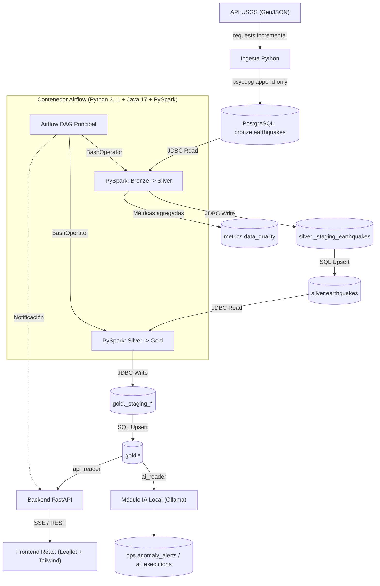

# Arquitectura de la Plataforma de Análisis Sísmico

Este documento detalla la arquitectura técnica, los componentes del sistema, el flujo de datos y el rol de Apache Spark en la plataforma de análisis sísmico.

---

## 1. Diagrama General de Componentes



---

## 2. Spark en este proyecto

### ¿Qué es Spark y qué problema resuelve?
Apache Spark es un motor de computación unificado de código abierto diseñado para el procesamiento y transformación distribuida de datos en memoria. A diferencia de soluciones tradicionales que leen y escriben en disco en cada paso intermedio, Spark mantiene los conjuntos de datos en memoria RAM estructurada, acelerando de 10 a 100 veces el procesamiento de transformaciones complejas, agregaciones y uniones.

### Rol de Spark en cada paso del pipeline
1. **Bronze → Silver**:
   - Lee los datos crudos en JSONB desde PostgreSQL por JDBC (`payload::text`).
   - Parsea el JSON mediante `from_json` con un esquema explícito y tipado estricto.
   - Aplica validaciones de calidad de datos mediante expresiones de columna (`filter`, `when`).
   - Descarta los registros que infringen reglas de negocio y calcula los contadores de rechazo para `metrics.data_quality`.
   - Deduplica por `event_id` conservando la versión con el `source_updated_at` más reciente.
   - Escribe en la tabla de staging para el posterior upsert atómico en `silver.earthquakes`.
2. **Silver → Gold**:
   - Lee `silver.earthquakes` por JDBC.
   - Calcula métricas horarias y agregados espaciales (`groupBy("region", "hour_bucket")`).
   - Genera la distribución de sismos por rangos de magnitud y el ranking de actividad en las últimas 24 horas.
   - Escribe en las tablas analíticas de Gold mediante el patrón de staging + upsert.

### DataFrame de Spark frente a un DataFrame tradicional y Evaluación Perezosa
- **DataFrame tradicional (en memoria local de proceso)**: Ejecuta cada operación de forma inmediata e imperativa. Todo el conjunto de datos debe residir en la memoria del hilo de Python.
- **DataFrame de Spark**: Es una abstracción sobre un plan lógico distribuido (Catalyst Optimizer). Implementa **evaluación perezosa** (*lazy evaluation*):
  - **Transformaciones** (`select`, `filter`, `groupBy`, `withColumn`): No ejecutan cómputo de inmediato; simplemente construyen un grafo acíclico dirigido (DAG) de dependencias lógicas.
  - **Acciones** (`count`, `collect`, `write.jdbc`): Disparan la optimización del plan físico y la ejecución real de las operaciones en la JVM.

### Particiones y Shuffle
- **Particiones**: Divisiones físicas de un DataFrame que pueden procesarse en paralelo. En nuestro entorno local conservador se configuran 4 particiones (`spark.sql.shuffle.partitions=4`), evitando sobrecargar la memoria.
- **Shuffle**: Es la redistribución física de datos entre particiones a través de la red o memoria. Ocurre durante transformaciones que requieren agrupar datos con una clave común (`groupBy("region")`, `join`, `distinct`). En este pipeline, el shuffle ocurre al calcular las estadísticas horarias por región en la capa Gold y al deduplicar por `event_id` en Silver.

### ¿Qué significa `local[*]` y por qué se usa?
`local[*]` le indica a Spark que ejecute el driver y los ejecutores dentro del mismo proceso de la JVM, utilizando todos los núcleos lógicos de CPU disponibles en la máquina local. Se utiliza porque el volumen de datos de eventos sísmicos no justifica la sobrecarga operativa, consumo de memoria ni complejidad de un clúster distribuido, pero permite conservar exactamente la misma API y lógica que escalaría a nivel empresarial.

### Conexión a PostgreSQL (JDBC) e Idempotencia
Spark se conecta a PostgreSQL mediante el driver JDBC oficial (`org.postgresql.Driver`).
- **Problema de idempotencia**: La API de JDBC de Spark soporta `mode("append")` o `mode("overwrite")`, pero no sentencias nativas de tipo `ON CONFLICT DO UPDATE` (upsert).
- **Solución implementada**:
  1. Spark escribe el lote en una tabla volátil de staging (`silver._staging_earthquakes`) con `.mode("overwrite")`.
  2. Inmediatamente después, una sentencia SQL ejecutada mediante `psycopg` transfiere los datos a la tabla final:
     ```sql
     INSERT INTO silver.earthquakes (...)
     SELECT ... FROM silver._staging_earthquakes
     ON CONFLICT (event_id) DO UPDATE SET
       magnitude = EXCLUDED.magnitude,
       updated_at_utc = EXCLUDED.updated_at_utc,
       ...
     WHERE EXCLUDED.updated_at_utc >= silver.earthquakes.updated_at_utc;
     ```
Esto garantiza que ejecutar dos veces el mismo intervalo nunca duplica filas y siempre actualiza a la versión más reciente.

### Escalabilidad: Del modo local a Clúster
El código de PySpark escrito en este proyecto es 100% agnóstico al modo de ejecución. Para procesar millones de eventos por segundo en producción:
- Solo se cambia `SPARK_MASTER` de `local[*]` a `spark://master:7077` (clúster Standalone), `yarn` o `k8s://...` (Kubernetes).
- Las funciones de transformación, parsing de esquemas y lógica de calidad no requieren modificarse ni reescribirse.

### Orquestación con Airflow y aislamiento de fallos
Airflow orquesta los pasos de Spark mediante tareas independientes invocadas con `BashOperator` (`python -m src.processing...`).
- **Aislamiento**: Cada ejecución arranca una JVM limpia y la termina al finalizar la tarea, liberando la memoria RAM al sistema operativo.
- **Manejo de fallos**: Si Spark falla durante una validación o conexión JDBC, la tarea de Airflow se marca en estado `FAILED`, se activan los reintentos automáticos configurados y las tablas finales nunca se corrompen gracias al aislamiento transaccional del staging.

---

## 3. Configuración y Comprobación del Classpath del Driver JDBC

### Configuración del Driver
1. **Archivo JAR**: Descargado y fijado en `jars/postgresql-42.7.3.jar` (local) y en `/opt/airflow/jars/postgresql-42.7.3.jar` (en la imagen Docker).
2. **Propiedades Spark**:
   - `spark.jars`: Ruta al archivo JAR.
   - `spark.driver.extraClassPath`: Ruta al JAR en el classpath del driver JVM.
   - `spark.executor.extraClassPath`: Ruta al JAR en los ejecutores.

### Verificación Técnica
El classpath se verifica programáticamente consultando al ClassLoader de la JVM:
```python
spark._jvm.java.lang.Class.forName("org.postgresql.Driver")
```
Si la clase no está en el classpath, la llamada lanza `ClassNotFoundException`. El script [`src/processing/verify_spark_jdbc.py`](file:///home/cohorte-5/Escritorio/prueba_final/src/processing/verify_spark_jdbc.py) ejecuta esta comprobación de forma automatizada.
