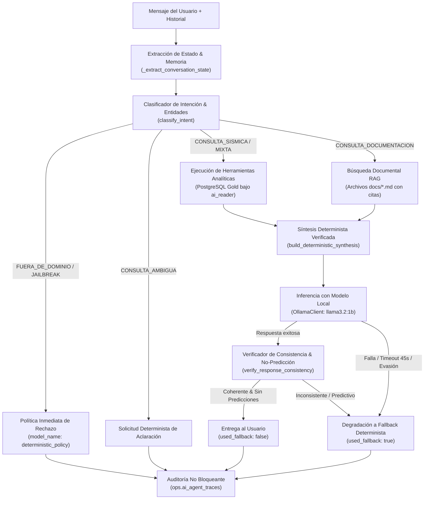

# Arquitectura de la Plataforma de Análisis Sísmico

Este documento detalla la arquitectura técnica, los componentes del sistema, el flujo de datos y el rol de Apache Spark en la plataforma de análisis sísmico.

---

## 1. Diagrama General de Componentes

```mermaid
flowchart TD
    USGS["API USGS (GeoJSON)"] -->|requests incremental| INGEST["Ingesta Python"]
    INGEST -->|psycopg append-only| BRONZE[("PostgreSQL: bronze.earthquakes")]

    subgraph AirflowContainer["Contenedor Airflow (Python 3.11 + Java 17 + PySpark)"]
        DAG["Airflow DAG Principal"] -->|BashOperator| SPARK_SILVER["PySpark: Bronze -> Silver"]
        DAG -->|BashOperator| SPARK_GOLD["PySpark: Silver -> Gold"]
    end

    BRONZE -->|JDBC Read| SPARK_SILVER
    SPARK_SILVER -->|JDBC Write| STAGING_SILVER[("silver._staging_earthquakes")]
    STAGING_SILVER -->|SQL Upsert| SILVER[("silver.earthquakes")]
    SPARK_SILVER -->|Métricas agregadas| QUALITY[("metrics.data_quality")]

    SILVER -->|JDBC Read| SPARK_GOLD
    SPARK_GOLD -->|JDBC Write| STAGING_GOLD[("gold._staging_*")]
    STAGING_GOLD -->|SQL Upsert| GOLD[("gold.*")]

    GOLD -->|ai_reader| AI_MODULE["Módulo IA Local (Ollama)"]
    AI_MODULE --> OPS[("ops.anomaly_alerts / ai_executions")]

    GOLD -->|ai_reader (Herramientas)| AGENT["Agente Conversacional IA\n(Herramientas + RAG + Verificador)"]
    DOCS[("Documentación Técnica\n(docs/*.md)")] -->|Búsqueda BM25| AGENT
    AGENT --> TRACES[("ops.ai_agent_traces")]
    AGENT <-->|Inferencia Local / Fallback| AI_MODULE

    GOLD -->|api_reader| FASTAPI["Backend FastAPI"]
    AGENT --> FASTAPI
    DAG -.->|Notificación| FASTAPI
    FASTAPI -->|SSE / REST| REACT["Frontend React (Leaflet + Chatbot + Tailwind)"]
```

---

## 2. Spark en este proyecto

### ¿Qué es Spark y qué problema resuelve?
Apache Spark es un motor de computación unificado de código abierto diseñado para el procesamiento y transformación distribuida de datos en memoria. A diferencia de soluciones tradicionales que leen y escriben en disco en cada paso intermedio, Spark mantiene los conjuntos de datos en memoria RAM estructurada, acelerando de 10 a 100 veces el procesamiento de transformaciones complejas, agregaciones y uniones.

### Rol de Spark en cada paso del pipeline
1. **Bronze → Silver**:
   - Lee los datos crudos en JSONB desde PostgreSQL por JDBC (`payload::text`).
   - Parsea el JSON mediante `from_json` con un esquema explícito y tipado estricto.
   - Aplica validaciones de calidad de datos mediante expresiones de columna (`filter`, `when`).
   - Descarta los registros que infringen reglas de negocio y calcula los contadores de rechazo para `metrics.data_quality`.
   - Deduplica por `event_id` conservando la versión con el `source_updated_at` más reciente.
   - Escribe en la tabla de staging para el posterior upsert atómico en `silver.earthquakes`.
2. **Silver → Gold**:
   - Lee `silver.earthquakes` por JDBC.
   - Calcula métricas horarias y agregados espaciales (`groupBy("region", "hour_bucket")`).
   - Genera la distribución de sismos por rangos de magnitud y el ranking de actividad en las últimas 24 horas.
   - Escribe en las tablas analíticas de Gold mediante el patrón de staging + upsert.

### DataFrame de Spark frente a un DataFrame tradicional y Evaluación Perezosa
- **DataFrame tradicional (en memoria local de proceso)**: Ejecuta cada operación de forma inmediata e imperativa. Todo el conjunto de datos debe residir en la memoria del hilo de Python.
- **DataFrame de Spark**: Es una abstracción sobre un plan lógico distribuido (Catalyst Optimizer). Implementa **evaluación perezosa** (*lazy evaluation*):
  - **Transformaciones** (`select`, `filter`, `groupBy`, `withColumn`): No ejecutan cómputo de inmediato; simplemente construyen un grafo acíclico dirigido (DAG) de dependencias lógicas.
  - **Acciones** (`count`, `collect`, `write.jdbc`): Disparan la optimización del plan físico y la ejecución real de las operaciones en la JVM.

### Particiones y Shuffle
- **Particiones**: Divisiones físicas de un DataFrame que pueden procesarse en paralelo. En nuestro entorno local conservador se configuran 4 particiones (`spark.sql.shuffle.partitions=4`), evitando sobrecargar la memoria.
- **Shuffle**: Es la redistribución física de datos entre particiones a través de la red o memoria. Ocurre durante transformaciones que requieren agrupar datos con una clave común (`groupBy("region")`, `join`, `distinct`). En este pipeline, el shuffle ocurre al calcular las estadísticas horarias por región en la capa Gold y al deduplicar por `event_id` en Silver.

### ¿Qué significa `local[*]` y por qué se usa?
`local[*]` le indica a Spark que ejecute el driver y los ejecutores dentro del mismo proceso de la JVM, utilizando todos los núcleos lógicos de CPU disponibles en la máquina local. Se utiliza porque el volumen de datos de eventos sísmicos no justifica la sobrecarga operativa, consumo de memoria ni complejidad de un clúster distribuido, pero permite conservar exactamente la misma API y lógica que escalaría a nivel empresarial.

### Conexión a PostgreSQL (JDBC) e Idempotencia
Spark se conecta a PostgreSQL mediante el driver JDBC oficial (`org.postgresql.Driver`).
- **Problema de idempotencia**: La API de JDBC de Spark soporta `mode("append")` o `mode("overwrite")`, pero no sentencias nativas de tipo `ON CONFLICT DO UPDATE` (upsert).
- **Solución implementada**:
  1. Spark escribe el lote en una tabla volátil de staging (`silver._staging_earthquakes`) con `.mode("overwrite")`.
  2. Inmediatamente después, una sentencia SQL ejecutada mediante `psycopg` transfiere los datos a la tabla final:
     ```sql
     INSERT INTO silver.earthquakes (...)
     SELECT ... FROM silver._staging_earthquakes
     ON CONFLICT (event_id) DO UPDATE SET
       magnitude = EXCLUDED.magnitude,
       updated_at_utc = EXCLUDED.updated_at_utc,
       ...
     WHERE EXCLUDED.updated_at_utc >= silver.earthquakes.updated_at_utc;
     ```
Esto garantiza que ejecutar dos veces el mismo intervalo nunca duplica filas y siempre actualiza a la versión más reciente.

### Escalabilidad: Del modo local a Clúster
El código de PySpark escrito en este proyecto es 100% agnóstico al modo de ejecución. Para procesar millones de eventos por segundo en producción:
- Solo se cambia `SPARK_MASTER` de `local[*]` a `spark://master:7077` (clúster Standalone), `yarn` o `k8s://...` (Kubernetes).
- Las funciones de transformación, parsing de esquemas y lógica de calidad no requieren modificarse ni reescribirse.

### Orquestación con Airflow y aislamiento de fallos
Airflow orquesta los pasos de Spark mediante tareas independientes invocadas con `BashOperator` (`python -m src.processing...`).
- **Aislamiento**: Cada ejecución arranca una JVM limpia y la termina al finalizar la tarea, liberando la memoria RAM al sistema operativo.
- **Manejo de fallos**: Si Spark falla durante una validación o conexión JDBC, la tarea de Airflow se marca en estado `FAILED`, se activan los reintentos automáticos configurados y las tablas finales nunca se corrompen gracias al aislamiento transaccional del staging.

---

## 3. Configuración y Comprobación del Classpath del Driver JDBC

### Configuración del Driver
1. **Archivo JAR**: Descargado y fijado en `jars/postgresql-42.7.3.jar` (local) y en `/opt/airflow/jars/postgresql-42.7.3.jar` (en la imagen Docker).
2. **Propiedades Spark**:
   - `spark.jars`: Ruta al archivo JAR.
   - `spark.driver.extraClassPath`: Ruta al JAR en el classpath del driver JVM.
   - `spark.executor.extraClassPath`: Ruta al JAR en los ejecutores.

### Verificación Técnica
El classpath se verifica programáticamente consultando al ClassLoader de la JVM:
```python
spark._jvm.java.lang.Class.forName("org.postgresql.Driver")
```
Si la clase no está en el classpath, la llamada lanza `ClassNotFoundException`. El script [`src/processing/verify_spark_jdbc.py`](file:///home/cohorte-5/Escritorio/prueba_final/src/processing/verify_spark_jdbc.py) ejecuta esta comprobación de forma automatizada.

---

## 4. Seguridad, Segregación de Roles y Aislamiento

### Principio de Mínimos Privilegios en Base de Datos
La base de datos implementa tres roles técnicos con permisos estrictamente acotados:

1. **`pipeline`** (Orquestador Airflow y tareas Spark):
   - Privilegios completos (`ALL PRIVILEGES`) sobre los esquemas `bronze`, `silver`, `gold`, `metrics` y `ops`.
   - Es el único rol autorizado a escribir en Bronze, transformar a Silver/Gold y registrar métricas operativas.
2. **`api_reader`** (Backend FastAPI):
   - Permiso exclusivo de solo lectura (`SELECT`) sobre las tablas analíticas de `gold`, las métricas de calidad (`metrics.data_quality`), las alertas operativas (`ops.anomaly_alerts`) y el control de disponibilidad (`ops.data_availability`).
   - Tiene revocado explícitamente el acceso a las capas `bronze` y `silver`, a las tablas de control interno y no posee permisos de escritura (`INSERT`, `UPDATE`, `DELETE`) en ninguna tabla.
3. **`ai_reader`** (Agente de Automatización IA):
   - Acceso restringido exclusivamente a vistas agregadas y métricas precalculadas de `gold` y `ops.anomaly_alerts`.
   - **Aislamiento absoluto**: El contenedor de inferencia Ollama ni el modelo local conocen credenciales de base de datos ni tienen conexión de red con PostgreSQL. Los datos analíticos precalculados son suministrados mediante scripts Python intermedios controlados.

### Aislamiento de Red en Contenedores
- Todos los servicios se ejecutan dentro de la red privada tipo puente `seismic_network`.
- La base de datos expone su puerto interno `5432` a los contenedores y un mapeo configurable (`5433` por defecto) al host local para evitar colisiones con instancias de PostgreSQL preexistentes.
- FastAPI se expone en el puerto `8000`, Airflow en el `8080`, el Dashboard web en el `3000` y Ollama en el `11434`.

---

## 5. Agente Conversacional de IA, Orquestación de Herramientas y RAG

La plataforma dispone de un agente analítico inteligente en [`src/ai/chat_service.py`](file:///home/cohorte-5/Escritorio/prueba_final/src/ai/chat_service.py) diseñado para responder consultas técnicas y analíticas sin alucinaciones:



### 1. Clasificación de Intenciones y Seguridad
El módulo [`src/ai/intent.py`](file:///home/cohorte-5/Escritorio/prueba_final/src/ai/intent.py) procesa el mensaje del usuario y su historial previo:
- **Seguridad y Rechazo Fuera de Dominio**: Detecta temas no relacionados (ej. recetas, deportes) e intentos de eludir instrucciones del sistema (jailbreaks), respondiendo inmediatamente sin consultar la base de datos ni invocar al modelo.
- **Detección de Ambigüedad**: Solicita aclaraciones si la consulta carece de parámetros mínimos para evitar búsquedas costosas.
- **Enrutamiento Inteligente**: Asigna las herramientas adecuadas según la intención (`CONSULTA_SISMICA`, `CONSULTA_DOCUMENTACION`, `CONSULTA_MIXTA`).

### 2. Catálogo de Herramientas Analíticas (Solo Lectura)
Ubicadas en [`src/ai/tools/`](file:///home/cohorte-5/Escritorio/prueba_final/src/ai/tools/):
- `get_strongest_earthquake`: Consulta el sismo de mayor magnitud filtrando por fecha y región.
- `get_earthquake_statistics`: Calcula conteo de eventos, promedio de magnitud y conteo de tsunamis.
- `get_latest_earthquakes`: Lista cronológica de los últimos eventos registrados.
- `get_earthquakes_by_region`: Desglose de actividad por región geográfica.
- `compare_earthquake_periods`: Compara variaciones de frecuencia y magnitudes entre dos intervalos temporales.
- `get_magnitude_distribution`: Distribución por intervalos analíticos.
- `get_anomaly_alerts`: Consulta de alertas estadísticas Z-Score recientes.
- `get_data_quality_metrics`: Métricas consolidadas del último lote en `metrics.data_quality`.

### 3. Recuperación Documental RAG con Citas de Fuente
En [`src/ai/rag.py`](file:///home/cohorte-5/Escritorio/prueba_final/src/ai/rag.py), la función `search_project_documentation` indexa y busca en tiempo real en los documentos oficiales (`docs/ARQUITECTURA.md`, `docs/MODELO_DATOS.md`, `docs/GOBERNANZA_OPENMETADATA.md`). Las respuestas documentales incluyen obligatoriamente la cita de la fuente técnica correspondiente.

### 4. Memoria Conversacional Multi-Turno
La función `_extract_conversation_state` analiza los turnos recientes del usuario para resolver referencias implícitas (ej. "¿Cuántos sismos se registraron en los últimos 7 días?" seguido de "¿Y cuántos superaron magnitud 4?"), preservando los filtros temporales y espaciales entre interacciones consecutivas.

### 5. Verificación Anti-Alucinación y Política de No-Predicción
El verificador [`src/ai/verifier.py`](file:///home/cohorte-5/Escritorio/prueba_final/src/ai/verifier.py) analiza cada respuesta antes de enviarla al usuario:
- **Consistencia de Cifras**: Asegura que el modelo no altere conteos ni magnitudes numéricas.
- **Advertencia No Predictiva Obligatoria**: Impide categóricamente cualquier afirmación predictiva o pronóstico de futuros sismos, garantizando rigor científico estricto.
- **Filtro Anti-Evasión**: Detecta respuestas donde el modelo pretenda declinar la consulta alegando fecha de corte de entrenamiento, activando de inmediato el respaldo fidedigno.

### 6. Fallback Determinista y Observabilidad
- Si Ollama está detenido, excede el tiempo límite de 45s o genera una salida no admitida, el sistema conmuta de forma transparente al motor de síntesis determinista (`build_deterministic_synthesis`).
- Cada interacción se registra en `ops.ai_agent_traces` (pregunta, intención, herramientas ejecutadas, latencia en ms, si utilizó fallback y motivo de rechazo si aplica).

### 7. Suite de Evaluación Cuantitativa
El directorio [`src/ai/eval/`](file:///home/cohorte-5/Escritorio/prueba_final/src/ai/eval/) contiene un dataset de 41 casos de referencia distribuidos en 12 categorías que evalúan sistemáticamente:
- Exactitud de intención (meta: >= 95%).
- Selección correcta de herramientas (meta: >= 95%).
- Tasa de rechazo de fuera de dominio (meta: 100%).
- Latencia de enrutamiento y procesamiento.
Se ejecuta mediante `python -m src.ai.eval.runner` o a través de `pytest tests/test_ai_agent_orchestrator.py`.
