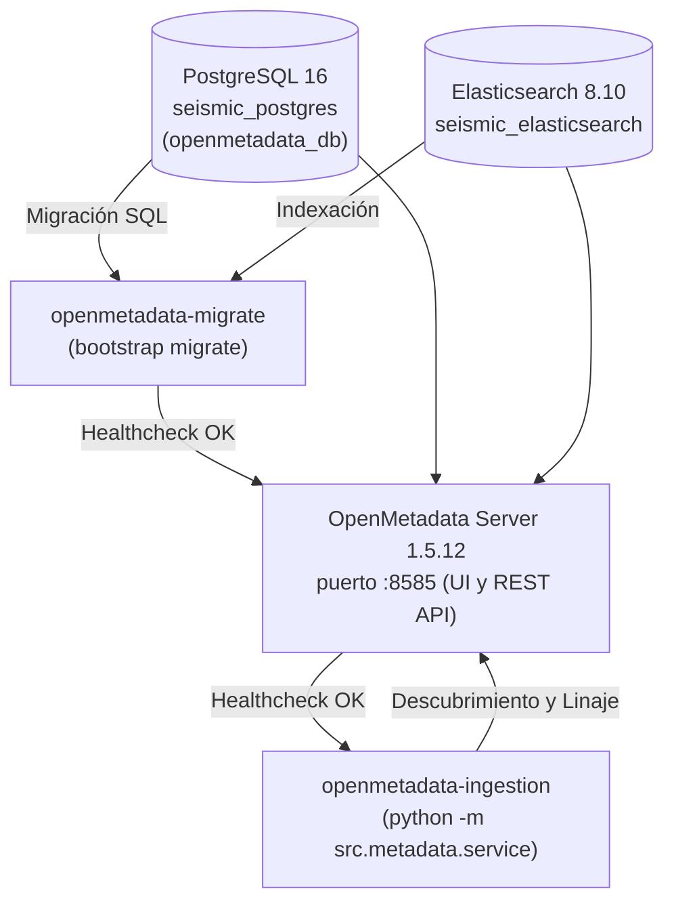
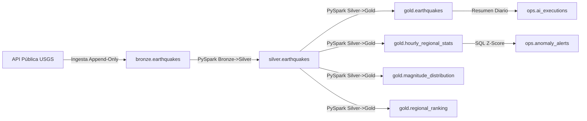

# Gobernanza y Catálogo de Datos con OpenMetadata

Este documento describe la integración funcional de **OpenMetadata** para la catalogación, clasificación Medallón, linaje de datos y observabilidad en la Plataforma de Análisis Sísmico.

---

## 1. Matriz de Compatibilidad de Versiones

| Componente | Versión Fijada | Imagen Docker | Justificación Técnica |
| :--- | :---: | :--- | :--- |
| **OpenMetadata Server** | `1.5.12` | `docker.getcollate.io/openmetadata/server:1.5.12` | Versión LTS probada con backend PostgreSQL y bajo consumo de memoria. |
| **Search Engine** | `8.10.2` | `docker.elastic.co/elasticsearch/elasticsearch:8.10.2` | Motor de búsqueda requerido por OpenMetadata 1.5.x; configurado con heap reducido (`-Xms512m -Xmx512m`). |
| **Base de Metadatos** | `16-alpine` | `seismic_postgres` (bd: `openmetadata_db`) | Reutiliza la instancia PostgreSQL existente para evitar contenedores redundantes. |
| **Orquestador** | `2.9.1` | `seismic-airflow:latest` | Airflow ejecuta el pipeline y expone linaje sin dependencias circulares. |
| **API REST Metadata** | `v1` | Cliente nativo Python (`httpx`) | Ingesta desacoplada mediante llamadas REST idempotentes (`PUT`). |

---

## 2. Arquitectura de Despliegue (Perfil `metadata`)

El catálogo de datos se despliega de forma modular mediante el perfil `metadata` de Docker Compose para no recargar el arranque del núcleo (`core`):



### Previsión de Dependencias y Arranque
- **Sin dependencias circulares**: La migración (`openmetadata-migrate`) corre una sola vez y finaliza exitosamente antes de que inicie `openmetadata-server`.
- **Ingesta desacoplada**: `openmetadata-ingestion` espera a que el servidor reporte salud en `/api/v1/system/version` antes de enviar el catálogo.

---

## 3. Catálogo de Activos y Clasificación Medallón

OpenMetadata cataloga todos los esquemas y tablas de `seismic_platform`:

| Esquema | Tabla | Clasificación / Etiqueta | Descripción |
| :--- | :--- | :--- | :--- |
| `bronze` | `earthquakes` | `Medallion.Bronze` | Almacén crudo inmutable append-only con payload GeoJSON original. |
| `silver` | `earthquakes` | `Medallion.Silver` | Eventos deduplicados, normalizados y validados por PySpark. |
| `gold` | `earthquakes` | `Medallion.Gold` | Tabla dimensional limpia para consultas geográficas y mapa Leaflet. |
| `gold` | `hourly_regional_stats` | `Medallion.Gold` | Agregaciones por hora y región para detección Z-Score. |
| `gold` | `magnitude_distribution` | `Medallion.Gold` | Distribución agregada por intervalos de magnitud. |
| `gold` | `regional_ranking` | `Medallion.Gold` | Ranking de las 10 regiones más activas en las últimas 24h. |
| `metrics` | `data_quality` | `Governance.Quality` | Registro de métricas de calidad y descarte en memoria por lote. |
| `ops` | `anomaly_alerts` | `Governance.Operations` | Alertas Z-Score de frecuencia sísmica inusual explicadas por IA. |
| `ops` | `ai_agent_traces` | `Governance.Operations` | Trazabilidad, intenciones, herramientas y latencia de consultas del asistente IA. |

---

## 4. Grafo de Linaje de Datos (Data Lineage)

OpenMetadata materializa el flujo extremo a extremo entre los activos de datos y los procesos de Airflow:



---

## 5. Integración con Airflow (Mejor Esfuerzo No Bloqueante)

### Alcance Real
- **Descubrimiento de DAGs**: Los DAGs principales (`usgs_seismic_pipeline`, `daily_seismic_executive_report`, `seismic_anomaly_detection`) se catalogan como servicios de pipeline en OpenMetadata.
- **Linaje de datos**: El linaje se declara a nivel de tabla conectando las fuentes y destinos de las transformaciones de PySpark y SQL.

### Limitaciones Identificadas
- **Enfoque no bloqueante**: La comunicación entre Airflow y OpenMetadata se ejecuta con bloques `try/except` y timeouts acotados. Si OpenMetadata está detenido o no responde, las tareas del pipeline **continúan operando con normalidad**.
- **No inyección de dependencias pesadas**: No se sobrecarga la imagen de Airflow con librerías de linaje en tiempo real que requieran sincronización síncrona en cada corrida de 15 minutos.

---

## 6. Procedimiento de Verificación y Uso

### 1. Levantar OpenMetadata
```bash
docker compose --profile metadata up -d
```

### 2. Verificar el arranque de los contenedores
```bash
docker compose ps
# seismic_elasticsearch        (puerto 9200)
# seismic_openmetadata_server  (puertos 8585, 8586, healthy)
```

### 3. Ejecutar la sincronización de metadatos manualmente (opcional)
```bash
python -m src.metadata.service
```

### 4. Acceso a la Interfaz Web de OpenMetadata
- **URL**: [http://localhost:8585](http://localhost:8585)
- **Credenciales por defecto**:
  - Usuario: `admin`
  - Contraseña: `admin`
- Podrás navegar a **Explore $\rightarrow$ Tables**, filtrar por la etiqueta `Medallion.Gold` o `Medallion.Silver`, y hacer clic en la pestaña **Lineage** para ver el grafo visual interactivo.
