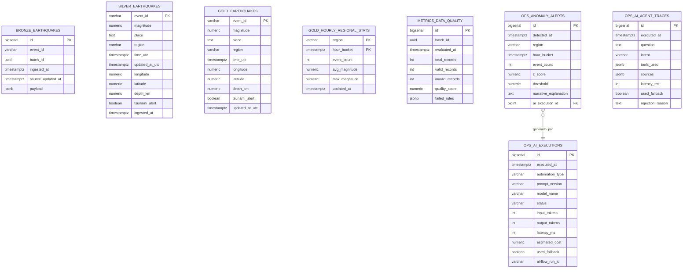

# Modelo de Datos - Plataforma de Análisis Sísmico

Este documento define la arquitectura de base de datos en PostgreSQL 16 para la plataforma de análisis sísmico basada en una arquitectura medallón (Bronze, Silver, Gold), junto con los esquemas de auditoría (`metrics`) y control operativo (`ops`).

---

## 1. Principios de Diseño

1. **Arquitectura Medallón Estricta**: Tres capas de datos en esquemas independientes (`bronze`, `silver`, `gold`).
2. **Sin Capas ni Tablas de Cuarentena**: Los registros que no cumplen las validaciones de calidad son descartados inmediatamente de la memoria durante el procesamiento Spark. No se almacenan eventos inválidos; únicamente se registran contadores agregados por regla en `metrics.data_quality`.
3. **Inmutabilidad en Bronze**: La capa Bronze es estrictamente *append-only* y almacena el feature GeoJSON original completo en una columna `JSONB`.
4. **Idempotencia mediante Staging y Upsert**: Spark escribe por JDBC en tablas intermedias de staging con `.mode("overwrite")`. Posteriormente, una instrucción SQL `INSERT ... ON CONFLICT (event_id) DO UPDATE` traslada los datos a las tablas finales de Silver y Gold garantizando que reprocesar un intervalo no duplica ni corrompe datos.
5. **Privilegios Mínimos**: Tres roles dedicados (`pipeline`, `api_reader`, `ai_reader`) con segregación estricta de permisos.

---

## 2. Esquemas y Tablas



---

### Capa Bronze (`bronze`)

#### `bronze.earthquakes`
Almacena los eventos crudos directamente extraídos de la API pública del USGS en formato append-only.

| Columna | Tipo | Nulo | Descripción |
| :--- | :--- | :---: | :--- |
| `id` | `BIGSERIAL` | No | Clave primaria técnica autoincremental. |
| `event_id` | `VARCHAR(50)` | No | Identificador único del evento en USGS (ej. `us7000abcd`). |
| `batch_id` | `UUID` | No | Identificador único del lote de extracción generado por Airflow. |
| `ingested_at` | `TIMESTAMPTZ` | No | Fecha y hora UTC en la que el registro se guardó en Bronze. |
| `source_updated_at` | `TIMESTAMPTZ` | No | Timestamp de última modificación reportado en el origen por el USGS. |
| `payload` | `JSONB` | No | Feature GeoJSON completo e intacto recibido de la API. |

**Índices**:
- `idx_bronze_event_id` en `(event_id)`
- `idx_bronze_ingested_at` en `(ingested_at)`
- `idx_bronze_source_updated_at` en `(source_updated_at)`
- `idx_bronze_batch_id` en `(batch_id)`

---

### Capa Silver (`silver`)

#### `silver.earthquakes`
Almacena eventos normalizados, tipados y deduplicados tras la ejecución de las validaciones de calidad de PySpark.

| Columna | Tipo | Nulo | Restricción | Descripción |
| :--- | :--- | :---: | :--- | :--- |
| `event_id` | `VARCHAR(50)` | No | `PRIMARY KEY` | Identificador natural del sismo. |
| `magnitude` | `NUMERIC(4,2)` | No | `CHECK (-2.0 A 10.0)` | Magnitud oficial del evento. |
| `place` | `TEXT` | Sí | | Descripción textual de la ubicación provista por USGS. |
| `region` | `VARCHAR(100)` | Sí | | Región geográfica normalizada extraída del campo `place`. |
| `time_utc` | `TIMESTAMPTZ` | No | | Momento exacto del sismo en tiempo universal coordinado. |
| `updated_at_utc` | `TIMESTAMPTZ` | No | | Última actualización del evento en origen. |
| `longitude` | `NUMERIC(9,6)` | No | `CHECK (-180.0 A 180.0)` | Coordenada geográfica de longitud decimal. |
| `latitude` | `NUMERIC(9,6)` | No | `CHECK (-90.0 A 90.0)` | Coordenada geográfica de latitud decimal. |
| `depth_km` | `NUMERIC(6,2)` | Sí | | Profundidad del hipocentro en kilómetros. |
| `tsunami_alert` | `BOOLEAN` | No | `DEFAULT FALSE` | Indicador binario de alerta de tsunami. |
| `ingested_at` | `TIMESTAMPTZ` | No | | Fecha y hora en la que el lote se insertó en Bronze. |
| `created_at` | `TIMESTAMPTZ` | No | `DEFAULT NOW()` | Fecha y hora en la que ingresó a Silver. |
| `updated_at` | `TIMESTAMPTZ` | No | `DEFAULT NOW()` | Fecha y hora de última modificación en Silver. |

**Índices**:
- `idx_silver_time_utc` en `(time_utc)`
- `idx_silver_magnitude` en `(magnitude)`
- `idx_silver_region` en `(region)`
- `idx_silver_coordinates` en `(latitude, longitude)`

#### `silver._staging_earthquakes`
Tabla técnica idéntica a `silver.earthquakes` utilizada como búfer intermedio volátil para el volcado de PySpark por JDBC previo a la sentencia de upsert.

---

### Capa Gold (`gold`)

Los consumidores finales (FastAPI, Dashboard React y agentes de IA) interactúan únicamente con las tablas de esta capa.

#### `gold.earthquakes`
Tabla optimizada con los eventos vigentes depurados para la carga del mapa interactivo y búsquedas con filtros combinados.

#### `gold.hourly_regional_stats`
Agregaciones horarias calculadas con PySpark para alimentar la detección de anomalías (Z-Score) y los gráficos temporales.

| Columna | Tipo | Nulo | Descripción |
| :--- | :--- | :---: | :--- |
| `region` | `VARCHAR(100)` | No | Nombre de la región sísmica (PK compuesta). |
| `hour_bucket` | `TIMESTAMPTZ` | No | Ventana horaria truncada a la hora (PK compuesta). |
| `event_count` | `INT` | No | Total de sismos ocurridos en dicha hora y región. |
| `avg_magnitude` | `NUMERIC(4,2)` | Sí | Magnitud promedio registrada. |
| `max_magnitude` | `NUMERIC(4,2)` | Sí | Magnitud máxima registrada en el intervalo. |
| `updated_at` | `TIMESTAMPTZ` | No | Timestamp del último recálculo analítico. |

#### `gold.magnitude_distribution`
Distribución agregada de eventos clasificados en rangos (ej. `2.5-3.4`, `3.5-4.4`, `4.5-5.4`, `5.5-6.4`, `6.5+`).

#### `gold.regional_ranking`
Tabla de posiciones de las regiones con mayor cantidad de sismos y magnitud máxima en las últimas 24 horas.

| Columna | Tipo | Nulo | Descripción |
| :--- | :--- | :---: | :--- |
| `region` | `VARCHAR(100)` | No | Nombre de la región (PK). |
| `total_events_24h` | `INT` | No | Total de sismos en la ventana móvil de 24 horas. |
| `max_magnitude_24h` | `NUMERIC(4,2)` | Sí | Magnitud máxima registrada en las últimas 24 horas. |
| `updated_at` | `TIMESTAMPTZ` | No | Timestamp de última actualización analítica. |

#### Tablas Técnicas de Staging en Gold
Para permitir la escritura idempotente por lotes desde PySpark por JDBC hacia PostgreSQL, la capa Gold dispone de tablas intermedias volátiles con esquema idéntico a las tablas finales pero sin restricciones de clave primaria:
- `gold._staging_earthquakes`
- `gold._staging_hourly_regional_stats`
- `gold._staging_magnitude_distribution`
- `gold._staging_regional_ranking`

Estas tablas son reescritas con `mode("overwrite")` por Spark y volcadas de forma atómica mediante sentencias SQL `INSERT ... ON CONFLICT DO UPDATE` y `TRUNCATE + INSERT` dentro de una transacción única gestionada por `psycopg`.

---

### Esquema de Calidad (`metrics`)

#### `metrics.data_quality`
Registra el resultado de la evaluación de calidad de datos ejecutada por PySpark para cada lote.

| Columna | Tipo | Descripción |
| :--- | :--- | :--- |
| `id` | `BIGSERIAL PK` | Identificador único de auditoría. |
| `batch_id` | `UUID` | Identificador del lote analizado. |
| `evaluated_at` | `TIMESTAMPTZ` | Momento de la validación. |
| `total_records` | `INT` | Total de registros evaluados. |
| `valid_records` | `INT` | Total de registros que cumplieron el 100% de las reglas y pasaron a Silver. |
| `invalid_records` | `INT` | Total de registros descartados. |
| `quality_score` | `NUMERIC(5,2)` | Puntaje porcentual: `(valid_records / total_records) * 100`. |
| `failed_rules` | `JSONB` | Conteo agregado por regla infringida (ej. `{"invalid_latitude": 3, "null_id": 1}`). |

---

### Esquema Operativo (`ops`)

#### `ops.ingestion_watermark`
Guarda el estado de la ingesta incremental para que Airflow consulte a la API del USGS usando el parámetro `updatedafter` sin reprocesar eventos innecesarios.

#### `ops.data_availability`
Registra la finalización exitosa del pipeline de datos. Sirve de disparador para que FastAPI envíe el evento de Server-Sent Events (SSE) notificando al frontend que debe refrescar la interfaz.

#### `ops.anomaly_alerts`
Almacena alertas de actividad sísmica inusual detectadas por la prueba estadística Z-Score sobre `gold.hourly_regional_stats` e incluye la explicación redactada por el modelo de IA local (o por el fallback determinista).

#### `ops.ai_executions`
Trazabilidad de cada llamada al modelo de IA local (Ollama). Registra tipo de automatización, versión del prompt, tokens procesados, latencia en milisegundos, costo estimado y si se activó el fallback determinista.

#### `ops.ai_agent_traces`
Observabilidad completa del agente conversacional inteligente. Registra cada consulta enviada por el usuario, la intención clasificada, la lista de herramientas analíticas ejecutadas en la capa Gold, citas de documentos RAG, latencia de procesamiento, indicación de fallback determinista y motivos de rechazo por política o seguridad.

| Columna | Tipo | Nulo | Descripción |
| :--- | :--- | :---: | :--- |
| `id` | `BIGSERIAL` | No | Clave primaria surrogate secuencial. |
| `executed_at` | `TIMESTAMPTZ` | No | Fecha y hora UTC del procesamiento (default `NOW()`). |
| `question` | `TEXT` | No | Mensaje enviado por el usuario al chatbot. |
| `intent` | `VARCHAR(50)` | No | Intención detectada (`CONSULTA_SISMICA`, `CONSULTA_DOCUMENTACION`, `FUERA_DE_DOMINIO`, etc.). |
| `tools_used` | `JSONB` | No | Arreglo JSON con los identificadores de herramientas analíticas ejecutadas. |
| `sources` | `JSONB` | No | Fuentes documentales citadas en consultas RAG. |
| `latency_ms` | `INT` | No | Latencia total de inferencia o síntesis en milisegundos. |
| `used_fallback` | `BOOLEAN` | No | Bandera que confirma si la respuesta provino del motor determinista. |
| `rejection_reason` | `TEXT` | Sí | Causa de rechazo si la consulta infringió políticas de seguridad o alcance. |

**Índices**:
- `idx_ops_traces_executed_at` en `(executed_at)`
- `idx_ops_traces_intent` en `(intent)`

---

## 3. Seguridad y Matriz de Roles

Se aplican principios de mínimos privilegios y segregación estricta de funciones:

| Esquema / Tabla | `pipeline` (Airflow / Spark) | `api_reader` (FastAPI) | `ai_reader` (Módulo IA) |
| :--- | :---: | :---: | :---: |
| `bronze.*` | `ALL` | *Sin acceso* | *Sin acceso* |
| `silver.*` | `ALL` | *Sin acceso* | *Sin acceso* |
| `gold.*` | `ALL` | `SELECT` | `SELECT` (Vistas agregadas) |
| `metrics.data_quality` | `ALL` | `SELECT` | *Sin acceso* |
| `ops.data_availability` | `ALL` | `SELECT` | *Sin acceso* |
| `ops.anomaly_alerts` | `ALL` | `SELECT` | `SELECT` |
| `ops.ai_executions` | `ALL` | *Sin acceso* | *Sin acceso* |
| `ops.ai_agent_traces` | `ALL` | `SELECT` | `SELECT` |
| `ops.ingestion_watermark` | `ALL` | *Sin acceso* | *Sin acceso* |

> [!SECURITY]
> El modelo de IA local (Ollama) no tiene acceso ni credenciales directas a la base de datos. El script de Python que lo invoca obtiene los datos precalculados de Gold utilizando el rol `ai_reader`, formula el prompt y posteriormente persiste el resultado en `ops` utilizando el rol `pipeline`.

---

## 4. Justificación Técnica de Tipos de Datos

| Tipo SQL | Columnas Clave | Justificación Técnica |
| :--- | :--- | :--- |
| `TIMESTAMPTZ` | `time_utc`, `ingested_at`, `updated_at_utc`, `hour_bucket` | Garantiza precisión temporal absoluta independiente de la zona horaria del host o contenedor, estandarizando todo en UTC. |
| `JSONB` | `bronze.earthquakes.payload`, `failed_rules` | Almacena estructuras semiestructuradas de forma binaria optimizada con soporte nativo de indexación GIN, permitiendo consultas internas y preservando la integridad del GeoJSON crudo original. |
| `NUMERIC(4,2)` | `magnitude` | Evita los errores de redondeo de punto flotante IEEE 754 binario (`FLOAT/DOUBLE`) en magnitudes sísmicas que típicamente tienen 2 decimales (ej. 5.72). |
| `NUMERIC(9,6)` | `latitude`, `longitude` | Proporciona una precisión submétrica (hasta ~11 cm en el ecuador), adecuada para coordenadas geográficas instrumentales sin deriva binaria. |
| `NUMERIC(6,2)` | `depth_km` | Permite representar profundidades desde 0.00 hasta 9999.99 km con dos decimales de precisión fija. |
| `UUID` | `batch_id` | Identificador universal único para trazabilidad de cada corrida de extracción de Airflow a lo largo de las capas. |
| `BIGSERIAL` | `id` en Bronze, Metrics y Ops | Clave primaria surrogate de 64 bits para soportar alto volumen secuencial sin riesgo de desbordamiento de enteros estándar. |

---

## 5. Políticas de Retención, Deduplicación y Preservación

1. **Preservación Inmutable en Bronze**:
   - Todo feature GeoJSON retornado por el API del USGS se almacena íntegro en `bronze.earthquakes.payload`.
   - La inserción es estrictamente *append-only*. Si el USGS publica una revisión de un sismo anterior (con el mismo `event_id` pero distinto `source_updated_at`), Bronze almacena ambos eventos como filas independientes para auditoría forense.
2. **Deduplicación en Silver**:
   - PySpark evalúa registros duplicados por `event_id` dentro del lote o contra la historia existente y conserva únicamente el registro con mayor `source_updated_at`.
   - El traspaso a la tabla final `silver.earthquakes` utiliza `ON CONFLICT (event_id) DO UPDATE ... WHERE EXCLUDED.updated_at_utc >= silver.earthquakes.updated_at_utc`, asegurando que no se sobreescriba un dato con una versión obsoleta.
3. **Retención de Datos**:
   - Por diseño, la base de datos almacena el histórico completo de sismos sin purgas destructivas en Bronze ni Silver.
   - Las tablas analíticas de Gold conservan agregaciones horarias y de 24 horas continuas para análisis temporal y estacional.

---

## 6. Reglas de Calidad y Umbrales Aplicados

El motor PySpark en [`src/quality/rules.py`](file:///home/cohorte-5/Escritorio/prueba_final/src/quality/rules.py) evalúa cada lote contra 5 reglas obligatorias:

| Regla | Expresión de Validación | Criterio de Aceptación | Acción ante Infracción |
| :--- | :--- | :--- | :--- |
| `rule_id_not_null` | `col("event_id").isNotNull() & (col("event_id") != "")` | ID no nulo y no vacío | Descarte en memoria, suma a `failed_rules["rule_id_not_null"]` |
| `rule_magnitude_valid` | `col("magnitude").isNotNull() & (magnitude >= -2.0) & (magnitude <= 10.0)` | Rango físico admisible | Descarte en memoria, suma a `failed_rules["rule_magnitude_valid"]` |
| `rule_time_valid` | `col("time_utc").isNotNull() & (time_utc <= current_timestamp())` | Fecha válida no futura | Descarte en memoria, suma a `failed_rules["rule_time_valid"]` |
| `rule_coordinates_valid` | `lat.between(-90, 90) & lon.between(-180, 180)` | Coordenadas en límites terrestres | Descarte en memoria, suma a `failed_rules["rule_coordinates_valid"]` |
| `rule_tsunami_valid` | `col("tsunami_alert").isNotNull()` | Indicador booleano presente | Descarte en memoria, suma a `failed_rules["rule_tsunami_valid"]` |

- **Umbral de Calidad del Pipeline**: Si el porcentaje de calidad (`quality_score = (valid / total) * 100`) cae por debajo del 80.0%, el pipeline de Airflow emite una advertencia crítica en logs. Si es 0%, aborta la corrida para evitar propagar datos corruptos a Gold.
- **Sin Tablas de Cuarentena**: Los eventos descartados nunca se insertan en tablas provisionales de "cuarentena"; únicamente se auditan en `metrics.data_quality`.

---

## 7. Variables de Entorno y Configuración

| Variable | Descripción | Valor por Defecto |
| :--- | :--- | :--- |
| `POSTGRES_HOST` | Host de base de datos PostgreSQL | `postgres` (o `localhost`) |
| `POSTGRES_PORT` | Puerto interno del contenedor | `5432` |
| `POSTGRES_HOST_PORT` | Puerto mapeado al host | `5433` |
| `POSTGRES_DB` | Nombre de la base de datos principal | `seismic_platform` |
| `POSTGRES_USER` | Usuario administrador para DDL inicial | `postgres_admin` |
| `POSTGRES_PIPELINE_PASSWORD` | Contraseña del rol `pipeline` | `pipeline_example_password` |
| `POSTGRES_API_READER_PASSWORD` | Contraseña del rol `api_reader` | `api_reader_example_password` |
| `POSTGRES_AI_READER_PASSWORD` | Contraseña del rol `ai_reader` | `ai_reader_example_password` |
| `USGS_API_BASE_URL` | Endpoint público del USGS | `https://earthquake.usgs.gov/fdsnws/event/1/query` |
| `USGS_MIN_MAGNITUDE` | Magnitud mínima de filtrado en ingesta | `2.5` |
| `INGEST_INTERVAL_MINUTES` | Periodicidad del DAG en minutos | `15` |
| `SPARK_MASTER` | Modo de ejecución de PySpark | `local[*]` |
| `SPARK_DRIVER_MEMORY` | Memoria máxima de driver Spark | `1g` |
| `SPARK_SHUFFLE_PARTITIONS` | Particiones de shuffle en memoria | `4` |
| `API_HOST` / `API_PORT` | Escucha del backend FastAPI | `0.0.0.0` / `8000` |
| `OLLAMA_BASE_URL` | Endpoint del servicio Ollama | `http://ollama:11434` (o `localhost:11434`) |
| `OLLAMA_MODEL` | Modelo ligero SLM (<= 3B parámetros) | `llama3.2:1b` |
| `AI_TIMEOUT_SECONDS` | Tiempo límite de inferencia Ollama | `45` |
| `AI_COST_PER_TOKEN` | Tarifa estimada por token procesado | `0.0` (cero por defecto para local) |
| `ANOMALY_ZSCORE_THRESHOLD` | Umbral estadístico para emitir alerta | `3.0` |
| `ANOMALY_MIN_OBSERVATIONS` | Mínimo de horas históricas para Z-Score | `24` |
| `OPENMETADATA_SERVER_URL` | Endpoint de catálogo OpenMetadata | `http://openmetadata-server:8585` |

---

## 8. Procedimientos Operativos y Recuperación ante Fallos

### Caída del Pipeline o Falla de Red con USGS
1. Si la API de USGS responde `429 Too Many Requests` o `5xx`, el cliente HTTP reintenta automáticamente hasta 3 veces con retroceso exponencial (`backoff_factor=1.5`).
2. Si la ingesta falla por completo, la marca de agua en `ops.ingestion_watermark` **no avanza**. En la siguiente ejecución, Airflow retoma la extracción desde la última marca exitosa, garantizando cero pérdida de eventos.

### Falla en la Tarea PySpark (Memoria o JDBC)
1. Dado que PySpark escribe primero en tablas temporales de staging (`silver._staging_*` y `gold._staging_*`) con aislamiento transaccional, un fallo a mitad de cálculo nunca corrompe ni borra las tablas productivas de `silver.earthquakes` ni `gold.earthquakes`.
2. Para recuperar manualmente una corrida fallida:
   ```bash
   python -m src.processing.bronze_to_silver
   python -m src.processing.silver_to_gold
   ```

### Indisponibilidad de Ollama o Timeout de Inferencia
1. Las llamadas a Ollama están protegidas con un timeout estricto de 45 segundos y un máximo de 2 reintentos.
2. Si el contenedor de Ollama no responde o el modelo excede el timeout, el sistema activa automáticamente el **fallback determinista**:
   - Redacta la explicación narrativa de la anomalía o el reporte ejecutivo utilizando plantillas formales basadas en las métricas numéricas ya calculadas.
   - Registra el evento en `ops.ai_executions` con `status='fallback'` y `used_fallback=true`.
   - **El pipeline principal y la disponibilidad de datos nunca se interrumpen**.

---

## 9. Gobernanza de Prompts y Validación de Respuestas IA

1. **Prompts Versionados**:
   - Todo prompt utilizado se encuentra en archivos de texto versionados en el directorio [`prompts/`](file:///home/cohorte-5/Escritorio/prueba_final/prompts/) (`anomaly_v1.txt`, `daily_summary_v1.txt`).
   - Las variables y cifras se inyectan mediante marcadores estandarizados sustituidos por Python (`{region}`, `{event_count}`, `{z_score}`, `{max_magnitude}`).
2. **Validación Estructurada Pydantic**:
   - Las respuestas de la IA se reciben y validan obligatoriamente contra modelos Pydantic (`AnomalyExplanationOutput`, `DailySummaryReportOutput`).
   - Si el modelo retorna texto no estructurado o un JSON incompleto, se rechaza y se recurre al fallback.
3. **Control Anti-Alucinación y Consistencia Numérica**:
   - Las cifras retornadas por el modelo son validadas contra los valores exactos precalculados. Si el modelo altera el conteo de eventos, la magnitud o afirma capacidad predictiva de futuros terremotos, la salida es descartada y sustituida por el fallback formal.
4. **Estimación de Costo Local**:
   - Para modelos locales ejecutados en CPU/GPU propia, el costo monetario directo por token es 0.0 (`AI_COST_PER_TOKEN=0.0`).
   - Si se configura una tarifa alternativa (ej. costo de amortización de infraestructura o electricidad), el sistema calcula el costo proporcional: `(input_tokens + output_tokens) * AI_COST_PER_TOKEN`.
