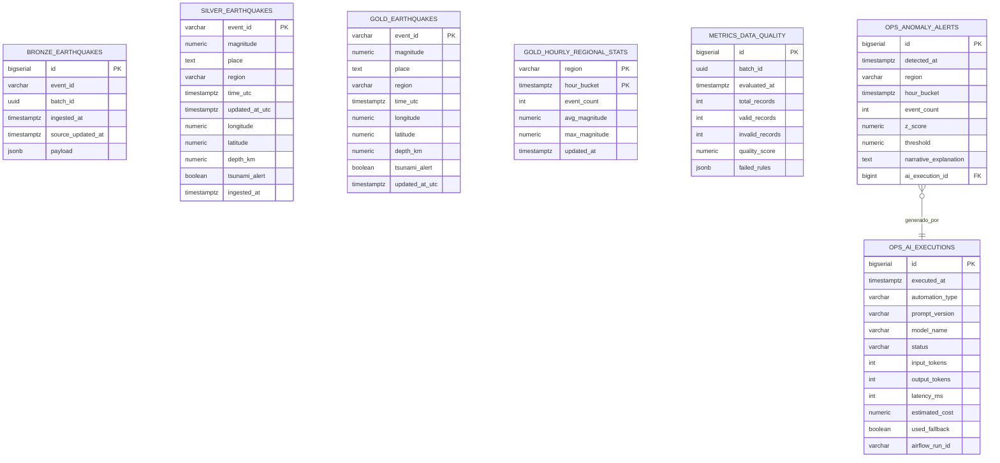

# Modelo de Datos - Plataforma de Análisis Sísmico

Este documento define la arquitectura de base de datos en PostgreSQL 16 para la plataforma de análisis sísmico basada en una arquitectura medallón (Bronze, Silver, Gold), junto con los esquemas de auditoría (`metrics`) y control operativo (`ops`).

---

## 1. Principios de Diseño

1. **Arquitectura Medallón Estricta**: Tres capas de datos en esquemas independientes (`bronze`, `silver`, `gold`).
2. **Sin Capas ni Tablas de Cuarentena**: Los registros que no cumplen las validaciones de calidad son descartados inmediatamente de la memoria durante el procesamiento Spark. No se almacenan eventos inválidos; únicamente se registran contadores agregados por regla en `metrics.data_quality`.
3. **Inmutabilidad en Bronze**: La capa Bronze es estrictamente *append-only* y almacena el feature GeoJSON original completo en una columna `JSONB`.
4. **Idempotencia mediante Staging y Upsert**: Spark escribe por JDBC en tablas intermedias de staging con `.mode("overwrite")`. Posteriormente, una instrucción SQL `INSERT ... ON CONFLICT (event_id) DO UPDATE` traslada los datos a las tablas finales de Silver y Gold garantizando que reprocesar un intervalo no duplica ni corrompe datos.
5. **Privilegios Mínimos**: Tres roles dedicados (`pipeline`, `api_reader`, `ai_reader`) con segregación estricta de permisos.

---

## 2. Esquemas y Tablas

---

### Capa Bronze (`bronze`)

#### `bronze.earthquakes`
Almacena los eventos crudos directamente extraídos de la API pública del USGS en formato append-only.

| Columna | Tipo | Nulo | Descripción |
| :--- | :--- | :---: | :--- |
| `id` | `BIGSERIAL` | No | Clave primaria técnica autoincremental. |
| `event_id` | `VARCHAR(50)` | No | Identificador único del evento en USGS (ej. `us7000abcd`). |
| `batch_id` | `UUID` | No | Identificador único del lote de extracción generado por Airflow. |
| `ingested_at` | `TIMESTAMPTZ` | No | Fecha y hora UTC en la que el registro se guardó en Bronze. |
| `source_updated_at` | `TIMESTAMPTZ` | No | Timestamp de última modificación reportado en el origen por el USGS. |
| `payload` | `JSONB` | No | Feature GeoJSON completo e intacto recibido de la API. |

**Índices**:
- `idx_bronze_event_id` en `(event_id)`
- `idx_bronze_ingested_at` en `(ingested_at)`
- `idx_bronze_source_updated_at` en `(source_updated_at)`
- `idx_bronze_batch_id` en `(batch_id)`

---

### Capa Silver (`silver`)

#### `silver.earthquakes`
Almacena eventos normalizados, tipados y deduplicados tras la ejecución de las validaciones de calidad de PySpark.

| Columna | Tipo | Nulo | Restricción | Descripción |
| :--- | :--- | :---: | :--- | :--- |
| `event_id` | `VARCHAR(50)` | No | `PRIMARY KEY` | Identificador natural del sismo. |
| `magnitude` | `NUMERIC(4,2)` | No | `CHECK (-2.0 A 10.0)` | Magnitud oficial del evento. |
| `place` | `TEXT` | Sí | | Descripción textual de la ubicación provista por USGS. |
| `region` | `VARCHAR(100)` | Sí | | Región geográfica normalizada extraída del campo `place`. |
| `time_utc` | `TIMESTAMPTZ` | No | | Momento exacto del sismo en tiempo universal coordinado. |
| `updated_at_utc` | `TIMESTAMPTZ` | No | | Última actualización del evento en origen. |
| `longitude` | `NUMERIC(9,6)` | No | `CHECK (-180.0 A 180.0)` | Coordenada geográfica de longitud decimal. |
| `latitude` | `NUMERIC(9,6)` | No | `CHECK (-90.0 A 90.0)` | Coordenada geográfica de latitud decimal. |
| `depth_km` | `NUMERIC(6,2)` | Sí | | Profundidad del hipocentro en kilómetros. |
| `tsunami_alert` | `BOOLEAN` | No | `DEFAULT FALSE` | Indicador binario de alerta de tsunami. |
| `ingested_at` | `TIMESTAMPTZ` | No | | Fecha y hora en la que el lote se insertó en Bronze. |
| `created_at` | `TIMESTAMPTZ` | No | `DEFAULT NOW()` | Fecha y hora en la que ingresó a Silver. |
| `updated_at` | `TIMESTAMPTZ` | No | `DEFAULT NOW()` | Fecha y hora de última modificación en Silver. |

**Índices**:
- `idx_silver_time_utc` en `(time_utc)`
- `idx_silver_magnitude` en `(magnitude)`
- `idx_silver_region` en `(region)`
- `idx_silver_coordinates` en `(latitude, longitude)`

#### `silver._staging_earthquakes`
Tabla técnica idéntica a `silver.earthquakes` utilizada como búfer intermedio volátil para el volcado de PySpark por JDBC previo a la sentencia de upsert.

---

### Capa Gold (`gold`)

Los consumidores finales (FastAPI, Dashboard React y agentes de IA) interactúan únicamente con las tablas de esta capa.

#### `gold.earthquakes`
Tabla optimizada con los eventos vigentes depurados para la carga del mapa interactivo y búsquedas con filtros combinados.

#### `gold.hourly_regional_stats`
Agregaciones horarias calculadas con PySpark para alimentar la detección de anomalías (Z-Score) y los gráficos temporales.

| Columna | Tipo | Nulo | Descripción |
| :--- | :--- | :---: | :--- |
| `region` | `VARCHAR(100)` | No | Nombre de la región sísmica (PK compuesta). |
| `hour_bucket` | `TIMESTAMPTZ` | No | Ventana horaria truncada a la hora (PK compuesta). |
| `event_count` | `INT` | No | Total de sismos ocurridos en dicha hora y región. |
| `avg_magnitude` | `NUMERIC(4,2)` | Sí | Magnitud promedio registrada. |
| `max_magnitude` | `NUMERIC(4,2)` | Sí | Magnitud máxima registrada en el intervalo. |
| `updated_at` | `TIMESTAMPTZ` | No | Timestamp del último recálculo analítico. |

#### `gold.magnitude_distribution`
Distribución agregada de eventos clasificados en rangos (ej. `2.5-3.4`, `3.5-4.4`, `4.5-5.4`, `5.5-6.4`, `6.5+`).

#### `gold.regional_ranking`
Tabla de posiciones de las regiones con mayor cantidad de sismos y magnitud máxima en las últimas 24 horas.

| Columna | Tipo | Nulo | Descripción |
| :--- | :--- | :---: | :--- |
| `region` | `VARCHAR(100)` | No | Nombre de la región (PK). |
| `total_events_24h` | `INT` | No | Total de sismos en la ventana móvil de 24 horas. |
| `max_magnitude_24h` | `NUMERIC(4,2)` | Sí | Magnitud máxima registrada en las últimas 24 horas. |
| `updated_at` | `TIMESTAMPTZ` | No | Timestamp de última actualización analítica. |

#### Tablas Técnicas de Staging en Gold
Para permitir la escritura idempotente por lotes desde PySpark por JDBC hacia PostgreSQL, la capa Gold dispone de tablas intermedias volátiles con esquema idéntico a las tablas finales pero sin restricciones de clave primaria:
- `gold._staging_earthquakes`
- `gold._staging_hourly_regional_stats`
- `gold._staging_magnitude_distribution`
- `gold._staging_regional_ranking`

Estas tablas son reescritas con `mode("overwrite")` por Spark y volcadas de forma atómica mediante sentencias SQL `INSERT ... ON CONFLICT DO UPDATE` y `TRUNCATE + INSERT` dentro de una transacción única gestionada por `psycopg`.

---

### Esquema de Calidad (`metrics`)

#### `metrics.data_quality`
Registra el resultado de la evaluación de calidad de datos ejecutada por PySpark para cada lote.

| Columna | Tipo | Descripción |
| :--- | :--- | :--- |
| `id` | `BIGSERIAL PK` | Identificador único de auditoría. |
| `batch_id` | `UUID` | Identificador del lote analizado. |
| `evaluated_at` | `TIMESTAMPTZ` | Momento de la validación. |
| `total_records` | `INT` | Total de registros evaluados. |
| `valid_records` | `INT` | Total de registros que cumplieron el 100% de las reglas y pasaron a Silver. |
| `invalid_records` | `INT` | Total de registros descartados. |
| `quality_score` | `NUMERIC(5,2)` | Puntaje porcentual: `(valid_records / total_records) * 100`. |
| `failed_rules` | `JSONB` | Conteo agregado por regla infringida (ej. `{"invalid_latitude": 3, "null_id": 1}`). |

---

### Esquema Operativo (`ops`)

#### `ops.ingestion_watermark`
Guarda el estado de la ingesta incremental para que Airflow consulte a la API del USGS usando el parámetro `updatedafter` sin reprocesar eventos innecesarios.

#### `ops.data_availability`
Registra la finalización exitosa del pipeline de datos. Sirve de disparador para que FastAPI envíe el evento de Server-Sent Events (SSE) notificando al frontend que debe refrescar la interfaz.

#### `ops.anomaly_alerts`
Almacena alertas de actividad sísmica inusual detectadas por la prueba estadística Z-Score sobre `gold.hourly_regional_stats` e incluye la explicación redactada por el modelo de IA local (o por el fallback determinista).

#### `ops.ai_executions`
Trazabilidad de cada llamada al modelo de IA local (Ollama). Registra tipo de automatización, versión del prompt, tokens procesados, latencia en milisegundos, costo estimado y si se activó el fallback determinista.

---

## 3. Seguridad y Matriz de Roles

Se aplican principios de mínimos privilegios y segregación estricta de funciones:

| Esquema / Tabla | `pipeline` (Airflow / Spark) | `api_reader` (FastAPI) | `ai_reader` (Módulo IA) |
| :--- | :---: | :---: | :---: |
| `bronze.*` | `ALL` | *Sin acceso* | *Sin acceso* |
| `silver.*` | `ALL` | *Sin acceso* | *Sin acceso* |
| `gold.*` | `ALL` | `SELECT` | `SELECT` (Vistas agregadas) |
| `metrics.data_quality` | `ALL` | `SELECT` | *Sin acceso* |
| `ops.data_availability` | `ALL` | `SELECT` | *Sin acceso* |
| `ops.anomaly_alerts` | `ALL` | `SELECT` | `SELECT` |
| `ops.ai_executions` | `ALL` | *Sin acceso* | *Sin acceso* |
| `ops.ingestion_watermark` | `ALL` | *Sin acceso* | *Sin acceso* |

> [!SECURITY]
> El modelo de IA local (Ollama) no tiene acceso ni credenciales directas a la base de datos. El script de Python que lo invoca obtiene los datos precalculados de Gold utilizando el rol `ai_reader`, formula el prompt y posteriormente persiste el resultado en `ops` utilizando el rol `pipeline`.
